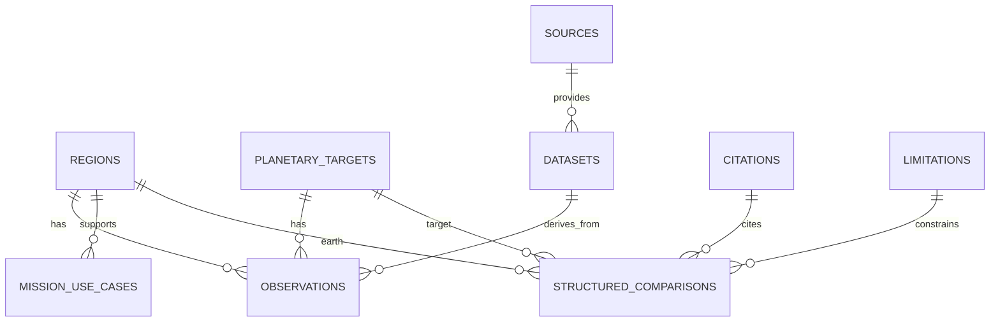

# PLAN DE DESARROLLO Y MEJORAS: ANALOGX
## NASA Space Apps Challenge 2026 — Reto: *Permanent Moon Base Locations and Mars*

> **Documento:** `docs/nasa-challenge-execution-plan.md`  
> **Proyecto:** AnalogX — Planetary Analog Discovery Engine  
> **Versión:** 2.0.0 (Fase 1 Extendida)  
> **Fecha de Elaboración:** Noviembre 2026  
> **Estado:** Aprobado para Ejecución Técnica  

---

## 1. Contexto y Objetivos del Reto de la NASA

El reto oficial [Permanent Moon Base Locations and Mars](https://www.spaceappschallenge.org/2026/challenges/permanent-moon-base-locations-and-mars/) exige que los equipos resuelvan cuatro necesidades fundamentales:

1. **Comparar datos de la Tierra con la Luna o Marte** utilizando bases de datos abiertas oficiales (misiones NASA, ESA, USGS).
2. **Identificar lugares "nuevos" o poco conocidos en la Tierra**, superando los análogos trillados (Atacama, Hawái, Antártida) con sitios específicos como salares de alta cota, campos geotermales, tubos de lava o minas.
3. **Explicar rigurosamente en qué se parecen y en qué NO se parecen**, documentando las divergencias físicas (gravedad, atmósfera, presión, radiación y temporalidad de procesos).
4. **Demostrar para qué serviría cada lugar en una misión espacial real** (*Rover testing*, calibración instrumental, habitabilidad de bases permanentes, protección contra radiación o extracción de recursos ISRU).
5. **Evaluar las 7 dimensiones clave:** Geología/Suelo, Terreno/Topografía, Clima Extremo, Agua/Hielo, Fenómenos Naturales, Subsuelo/Refugios y Biología Extrema.

---

## 2. Diagnóstico del Sistema Actual y Brechas a Resolver

```
┌─────────────────────────────────┬──────────────────────────────────┬──────────────────────────────────────────┐
│ Requisito NASA                  │ Estado Actual (Fase 0/1)         │ Brecha / Lo Nuevo por Implementar        │
├─────────────────────────────────┼──────────────────────────────────┼──────────────────────────────────────────┤
│ Destino Lunar (Bases Lunares)   │ Placeholder ("Objetivo por       │ Incorporar candidato real Artemis:       │
│                                 │ definir", sin datos de LRO).     │ Polo Sur Lunar (Shackleton / Malapert).  │
├─────────────────────────────────┼──────────────────────────────────┼──────────────────────────────────────────┤
│ Candidatos Terrestres Novedosos │ Uyuni (referencia) y Sol de      │ Incorporar Tubos de Lava / Cuevas        │
│                                 │ Mañana (novedad hidrotermal).    │ volcánicas y cumbres criogénicas Lípez.  │
├─────────────────────────────────┼──────────────────────────────────┼──────────────────────────────────────────┤
│ Justificación Operacional       │ Evaluamos variables científicas, │ Agregar campo y módulo: "¿Para qué sirve │
│ ("¿Para qué sirve el lugar?")   │ pero falta el caso de misión.    │ este lugar en misiones espaciales?".     │
├─────────────────────────────────┼──────────────────────────────────┼──────────────────────────────────────────┤
│ Base de Datos y Persistencia    │ Datos en memoria Pydantic.       │ Capa de persistencia relacional SQLite   │
│                                 │                                  │ con SQLModel/SQLAlchemy y seed script.   │
├─────────────────────────────────┼──────────────────────────────────┼──────────────────────────────────────────┤
│ Estructura Multidimensional     │ 6 variables en tabla plana.      │ Reagrupación en las 7 dimensiones        │
│                                 │                                  │ temáticas requeridas por el reto.        │
├─────────────────────────────────┼──────────────────────────────────┼──────────────────────────────────────────┤
│ Frontend para Pitch al Jurado   │ Interfaz funcional preliminar.   │ Tarjetas de utilidad de misión, selector │
│                                 │                                  │ Artemis/Mars y bitácora ejecutiva.       │
└─────────────────────────────────┴──────────────────────────────────┴──────────────────────────────────────────┘
```

---

## 3. Arquitectura de Base de Datos y Persistencia (SQLite + SQLModel)

Para garantizar **portabilidad absoluta** (los jueces y desarrolladores pueden clonar y ejecutar sin necesidad de configurar PostgreSQL o Docker) se implementará una base de datos relacional local con **SQLModel**:

### 3.1 Esquema de Tablas Relacionales



1. **`regions`:** Sitios terrestres (`id`, `name`, `body`, `study_role`, `country`, `lat`, `lon`, `elevation_min`, `elevation_max`, `crs_datum_id`, `novelty_level`, `novelty_justification`, `verification_status`).
2. **`planetary_targets`:** Objetivos extraterrestres (`id`, `name`, `planet_body`, `target_feature`, `center_lat`, `center_lon`, `crs_datum_id`, `verification_status`).
3. **`mission_use_cases`:** Casos de uso de ingeniería y misiones espaciales (`id`, `region_id`, `target_id`, `category`, `title`, `description`, `applicable_mission`, `trl_level`).
4. **`datasets`:** Catálogo de productos oficiales de NASA/ESA (`official_id`, `source_id`, `mission`, `instrument`, `resolution`, `units`, `download_url`, `strict_category`).
5. **`sources`:** Repositorios científicos (`id`, `name`, `agency`, `url`, `license`, `priority`).
6. **`citations`:** Artículos peer-reviewed y reportes técnicos (`id`, `title`, `authors`, `year`, `doi`, `url`).
7. **`observations`:** Mediciones individuales fácticas con los 13 atributos del Evidence Ledger.
8. **`limitations`:** Restricciones y divergencias físicas (`id`, `parameter`, `terrestrial_val`, `planetary_val`, `mechanism`, `impact`).
9. **`structured_comparisons`:** Matriz de comparabilidad dimensional.

### 3.2 Script de Semilla Inicial (`scripts/seed_database.py`)
* Lee automáticamente [research/dataset_catalog.csv](file:///home/chavezin/Desktop/backend_analogX/research/dataset_catalog.csv) y las definiciones científicas de Bolivia y Marte/Luna.
* Si el archivo local `analogx.db` no existe, se genera y puebla automáticamente en menos de 1 segundo al iniciar el servidor FastAPI.

---

## 4. Nuevo Módulo: Objetivos Lunares para Bases Permanentes (*Artemis Program*)

### 4.1 Objetivo Planetario: Polo Sur Lunar (Cráter Shackleton / Macizo de Malapert)
* **Coordenadas:** $89.9^\circ\text{ S}, 0.0^\circ\text{ E}$ (Borde del Cráter Shackleton) y $85.9^\circ\text{ S}, 2.9^\circ\text{ E}$ (Malapert Mountain).
* **Datum Vertical:** Esfera media lunar IAU 2000 ($R = 1737.4\text{ km}$).
* **Condiciones Ambientales:**
  * Regiones en Sombra Permanente (*PSR - Permanently Shadowed Regions*): $T \approx 40\text{ K} (-233^\circ\text{C})$, ausencia total de radiación solar directa.
  * Picos de Iluminación Casi Perpetua en bordes: Iluminación solar $>85-90\%$ del año lunar (ideal para granjas solares y bases permanentes).
  * Regolito anortosítico pulverizado con volátiles atrapados y presencia de hielo de agua en trampas frías.
* **Datasets Oficiales NASA LRO:**
  * `LRO_LOLA_DEM`: Altímetro láser LOLA (mallas topográficas de 20 m/px en polos).
  * `LRO_DIVINER_LST`: Sensor térmico infrarrojo Diviner (mapas de temperaturas criogénicas y estabilidad de hielo).
  * `LROC_NAC`: Mosaicos ópticos de ángulos de iluminación rasante (resolución submétrica).

### 4.2 Análogos Bolivianos Novedosos para la Luna
1. **Refugios Subterráneos en Tubos de Lava y Cuevas Volcánicas (Lípez / Complejo Uturuncu):**
   * *Analogía:* Estructuras basálticas/dacíticas subterráneas que emulan los tubos de lava de *Marius Hills* y pozos de colapso (*skylights*) lunares.
   * *Utilidad de Misión:* Pruebas de habitabilidad subterránea, despliegue de módulos inflables y técnicas de sellado de hábitats protegidos de radiación cósmica galáctica (GCR) y micrometeoritos.
2. **Ambiente Criogénico Hiperárido de Alta Cota (Cráter del Volcán Licancabur y Lagunas Blanca/Verde, 4,350 - 5,916 msnm):**
   * *Analogía:* Suelo rocoso anhidro con temperaturas nocturnas de hasta $-25^\circ\text{C}$, lagunas cubiertas de costras de hielo perennes bajo vacío parcial atmosférico y radiación UV máxima.
   * *Utilidad de Misión:* Pruebas de degradación de materiales para trajes de astronautas Artemis (xEMU), resistencia térmica de juntas mecánicas y sellos de esclusas.

---

## 5. Módulo Operacional: "¿Para Qué Serviría Este Lugar?" (*Mission Utility*)

Para cada análogo se establecerá una ficha operativa que responda a 4 casos de uso concretos de agencias espaciales:

```
┌─────────────────────────────────────────────────────────────────────────────┐
│                    CASOS DE USO PARA MISIONES ESPACIALES                    │
├──────────────────────────┬──────────────────────────────────────────────────┤
│ 1. Pruebas de Movilidad  │ • Tracción y deslizamiento en costras friables.  │
│    de Rovers             │ • Desgaste de ruedas metálicas en polígonos.    │
│                          │ • Misión análoga: Artemis VIPER / Mars Rover.    │
├──────────────────────────┼──────────────────────────────────────────────────┤
│ 2. Calibración           │ • Espectrómetros Raman / XRF portátiles.         │
│    Instrumental          │ • Detección de biofirmas en sílice y sulfatos.  │
│                          │ • Misión análoga: Mars 2020 SuperCam / SHERLOC.  │
├──────────────────────────┼──────────────────────────────────────────────────┤
│ 3. Hábitats y Bases      │ • Acondicionamiento de refugios subterráneos.   │
│    Permanentes           │ • Blindaje contra radiación UV y cósmica.       │
│                          │ • Misión análoga: Base Lunar Permanente Artemis. │
├──────────────────────────┼──────────────────────────────────────────────────┤
│ 4. Extracción de         │ • Obtención de H2O desde minerales hidratados.   │
│    Recursos (ISRU)       │ • Extracción de solutos en salmueras extremas.   │
│                          │ • Misión análoga: Soporte vital in situ ISRU.    │
└──────────────────────────┴──────────────────────────────────────────────────┘
```

---

## 6. Estructuración en las 7 Dimensiones del Reto de la NASA

En el motor y en la interfaz de comparación se presentará la evaluación dividida en los 7 factores oficiales:

1. **Geología y Suelo:** Minerales (halita, yeso, azufre nativo, alunita, sílice opalina vs. sales de cloruro y basaltos marcianos / anortosita lunar).
2. **Terreno y Topografía:** Mapeo de pendientes relativas ($z - z_{\min}$), rugosidad RMS decamétrica y confinamiento en cuencas.
3. **Clima Extremo:** Amplitud térmica diurna-nocturna ($-25^\circ\text{C}$ a $+20^\circ\text{C}$), presión reducida (540 mbar), radiación UV extrema (UVI $> 25$).
4. **Agua y Hielo:** Ciclos de inundación estacional somera en salares vs. paleolagos fósiles en Marte y trampas frías de hielo en cráteres lunares.
5. **Fenómenos Naturales:** Deflación eólica, tormentas de polvo altiplánicas, ventilación hidrotermal y desgasificación volcánica activa.
6. **Subsuelo y Refugios:** Cuevas y tubos de lava para habitabilidad subterránea, radar GPR para detección de interfaces de salmuera/hielo.
7. **Biología Extrema:** Arqueas halófilas, diatomeas de alta montaña y extremófilos en salmueras ácidas bajo radiación esterilizante.

---

## 7. Mejoras de Interfaz de Usuario (`frontend_analogX`)

### 7.1 Selector de Misión en `/explore` y `/compare`
* **Misión A:** *Marte — Paleocuencas de Cloruro de Terra Sirenum*.
* **Misión B:** *Luna — Base Permanente en el Polo Sur (Artemis Shackleton)*.

### 7.2 Tarjeta de Utilidad Operacional de Misión
* Integrar en el diálogo de detalle y en la columna de comparación un bloque visual con insignias de misión:
  `[ROVER TESTING]` `[INSTRUMENT CALIBRATION]` `[LUNAR BASE SHIELDING]` `[ISRU WATER EXTRACTION]`.

### 7.3 Bitácora Científica para el Pitch (`/findings`)
* Transformar `/findings` en un panel de presentación para los jueces de la NASA:
  * **Hallazgo 1 (Marte):** Por qué Sol de Mañana y Uyuni resuelven la calibración de instrumentos para buscar cloruros y biofirmas en cuencas de Marte.
  * **Hallazgo 2 (Luna):** Por qué las cuevas volcánicas y cumbres criogénicas de Lípez constituyen el banco de pruebas ideal para refugios de la base lunar permanente.

---

## 8. Fases y Tareas de Implementación

### Fase 1: Persistencia y Base de Datos (Backend)
- [ ] Instalar dependencias de base de datos (`sqlmodel` o `sqlalchemy` con SQLite).
- [ ] Definir modelos SQLModel en `app/models/db_models.py`.
- [ ] Crear script `scripts/seed_database.py` para cargar el catálogo CSV y entidades estructuradas.
- [ ] Inyectar la sesión en `app/api/v1/router.py` mediante `Depends(get_session)`.

### Fase 2: Modelo Lunar y Utilidad de Misiones (Backend + Datos)
- [ ] Agregar el objetivo lunar oficial `lunar-south-pole-shackleton` con datos de NASA LRO (LOLA, Diviner).
- [ ] Incorporar el candidato andino `bo_cuevas_lipez` (tubos de lava para base permanente).
- [ ] Añadir modelos y endpoints para casos de uso de misiones espaciales (`GET /api/missions/use-cases`).
- [ ] Extender la matriz de comparabilidad para cubrir las 7 dimensiones de la NASA.

### Fase 3: Integración y Visualización en Frontend
- [ ] Actualizar tipos en `frontend_analogX/src/lib/scientific-types.ts` y contratos en `src/lib/api.ts`.
- [ ] Integrar el selector de Misión Lunar Artemis vs. Misión Marte en `src/components/exploration.tsx`.
- [ ] Añadir la tarjeta visual de "Utilidad de Misión Espacial" en `/compare` y en la ficha modal de región.
- [ ] Enriquecer `/findings` con las fichas ejecutivas listas para la presentación al jurado.

### Fase 4: Pruebas, Smoke Tests y Documentación
- [ ] Verificar pruebas unitarias de backend con pytest (`test_models.py` y `test_db.py`).
- [ ] Ejecutar `npm run typecheck`, `npm run build` y `npm run test:smoke` en frontend.
- [ ] Generar resumen ejecutivo del proyecto en PDF/Markdown para la entrega oficial en la plataforma del NASA Space Apps Challenge.

